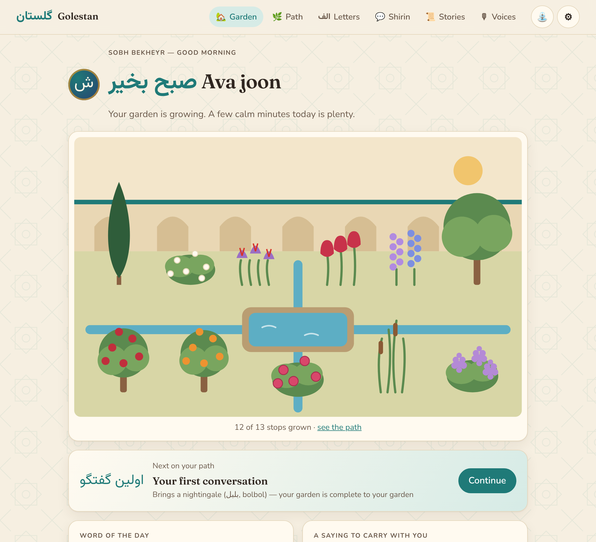

# گلستان · Golestan — Persian with Shirin

A calm little Persian garden for learning Farsi. It's built for an English speaker from Toronto with Scottish roots who wants to learn for joy: no exams, no streaks, no red crosses. The teacher, **Shirin** (شیرین, "sweet"), is warm and patient. She tells stories from Iranian history while you learn, and she understands a beginner's pronunciation without fuss.

Every finished lesson grows something in your own Persian courtyard garden: a cypress, jasmine, saffron, tulips, a pomegranate tree. When the path is complete, a nightingale arrives.



## What's inside

| | |
|---|---|
| 🏡 **Garden** | A greeting for the time of day, your garden, the next step, a word of the day, and a Persian saying |
| 🌿 **The path** | 13 short stops through all 32 letters. Each has letter cards, real words with the new letter highlighted, a gentle game, a story from Iran, and a new plant |
| ✨ **Lessons made for you** | Ask for anything ("ordering at a Persian bakery on Yonge", "Yalda night is coming"). Shirin thinks it through carefully and builds a lesson with words, phrases, a story and a quiz |
| الف **Letters** | All 32 letters grouped by shape family (same shape, different dots), each with its four forms, sound tips, example words and a tracing board |
| 💬 **Talk with Shirin** | Type or speak, in English, Persian or a mix. Replies can be read aloud |
| 📜 **Stories** | Paradise gardens, Nowruz, Yalda, Ferdowsi, Rumi, Saadi, Hafez, tea, ta'ârof… each with a bridge to Scotland or Toronto |
| 🎙 **Family voices** | A Persian speaker at home records the words, and every 🔊 button plays their voice |

## How Shirin is designed

**Her manner.** She is calm, unhurried and kind. She never says "wrong"; she says "so close" and "let's try together". She teaches one small thing at a time and keeps replies short. Each piece of Persian comes as script, then transliteration, then meaning: سلام (salâm) — hello.

**She understands imperfect speech.** A beginner's accent run through a speech recognizer comes out strange: "salâm" becomes "so lamb" and "khodâhâfez" becomes "hoda half is". Shirin is told to expect this. She works out what was meant from context and answers that. When a word needed fixing, she says it correctly back to you instead of pointing out the mistake. "Say it" practice works in two steps:
1. A quick, forgiving check in the browser (Persian spelling variants and transliteration both count).
2. If that isn't sure, Shirin listens to all of the recognizer's guesses and decides generously: *yes*, *almost* (with one small tip), or *try again*. After three tries she always moves on kindly.

**Bridges to her world.** خ is the "ch" in Scottish *loch*, and ر is a tapped Scottish *r*. Hogmanay pairs with Nowruz, Burns Night with Yalda and Hafez, and tartans with carpet patterns. Toronto's Iranian community, the Tirgan festival and the bakeries on Yonge all come up. So do the English words that came from Persian: paradise, bazaar, candy, checkmate.

**History with care.** The stories and the facts in Shirin's instructions are written to be accurate. She's told to say so when she isn't sure, and to keep politics out unless asked.

## The two model settings

Both run on **Claude Opus 5.5** (`claude-opus-5-5`), at different effort levels:

| Job | Effort | Why |
|---|---|---|
| **Designing lessons** (the ✨ lesson maker) | `xhigh` | Spelling, transliteration, everyday pronunciation, history and pacing all need careful thought. A lesson takes a minute or two, so the page shows a calm "brewing" animation. |
| **Talking and listening** (chat and pronunciation feedback) | `medium` | Fast and natural for live conversation. |

The settings are in [`server/config.ts`](server/config.ts) and can be changed with environment variables (`DESIGN_EFFORT`, `TALK_EFFORT`, `DESIGN_MODEL`, `TALK_MODEL`). Every request also:
- uses adaptive thinking;
- opts into Anthropic's **server-side fallback**, so a rare false-positive safety refusal is retried on another model instead of leaving Shirin silent;
- uses prompt caching for Shirin's long system prompt, which keeps chat quick and cheap.

## Getting started

You'll need **Node.js 22.18 or newer** and an **Anthropic API key** (from [platform.claude.com](https://platform.claude.com)).

```bash
npm install
cp .env.example .env        # then put your key in .env
npm start
```

Open **http://localhost:3000**.

Without a key, everything except chatting, "Say it" feedback from Shirin, and the lesson maker still works: the path, letters, games, tracing and stories.

### Using it on a phone or another computer

Browsers only allow the microphone on **https** pages (or `localhost`). To practise speaking from a phone, put the app behind https:
- **Deploy it** to any Node host (Render, Railway, Fly.io, a small VPS…). Set `ANTHROPIC_API_KEY`, and also **`APP_PASSCODE`** so only your household can use your key. Family voice recordings are saved in `data/voices/`, so give that folder a persistent disk.
- Or, for a quick try from home, run a tunnel such as `cloudflared tunnel --url http://localhost:3000` and open the https address it prints.

### Best browsers

- **Microsoft Edge**: the best. It can listen, and it has natural Persian voices (Dilara and Farid).
- **Chrome**: listens well. Chrome on Android also speaks Persian.
- **Safari (Mac/iPhone)**: can listen, but has no Persian voice. Use Family voices.
- **Firefox**: can't listen. "Say it" offers an "I said it!" button instead.

If a device has no Persian voice, the 🔊 buttons explain what to do. The best fix is Family voices: a native speaker at home taps **● Record** next to each word once, and from then on every device plays that voice. Set `FAMILY_PIN` if you want recording to need a PIN.

## Privacy

- Progress, chat history and custom lessons stay in the learner's browser (`localStorage`).
- Chat messages, speech-recognition text and lesson requests go to Anthropic's API to get Shirin's replies.
- Speech recognition is done by the browser. In Chrome and Edge that means Google's or Microsoft's speech service.
- Family voice recordings are stored as files on your server.

## Development

```bash
npm run dev        # restarts on changes
npm test           # 16 tests, offline (Claude is replaced by a local mock)
npm run typecheck  # checks the server against the Anthropic SDK types
```

The server tests start a fake Messages API and check the exact request Shirin sends: the model, the effort, adaptive thinking, the fallback opt-in and caching. The content tests check that all 32 letters are taught exactly once, that every highlighted letter really appears in its word, and that only Persian ی/ک are used.

```
server/
  config.ts     model routing (design = xhigh, talk = medium), passcodes
  prompts.ts    Shirin's character, teaching approach, bridges and facts
  claude.ts     chat (streamed), pronunciation judging, lesson design (structured output)
  app.ts        HTTP routes, family-voice storage, friendly errors
public/
  js/data/      the alphabet and the 13-stop path with its stories
  js/views/     garden, path, lesson player, letters, talk, stories, voices
  js/lib/       speech (listen/speak), Persian text helpers, storage, sounds
  js/garden.js  the courtyard garden that grows
test/           offline tests
```
