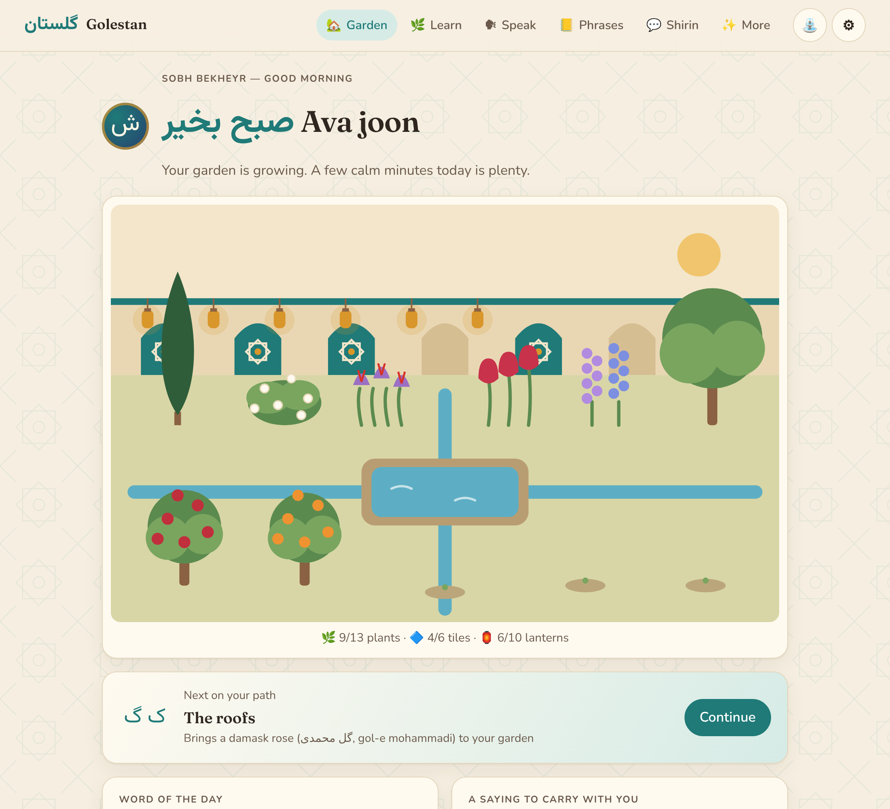
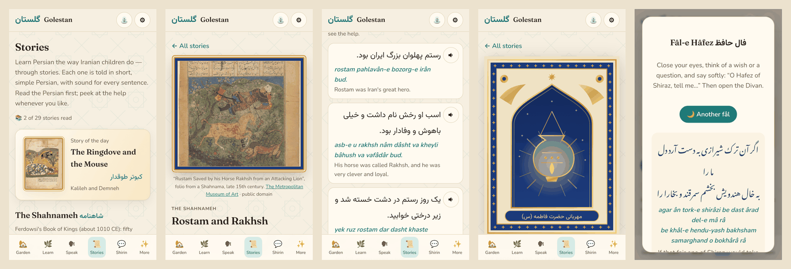

# گلستان · Golestan — Persian with Shirin

A calm Persian garden for learning to **read Persian and talk with Iranians on your own** — at home with family, and on a trip to Iran — without needing anyone to translate.

It was made for an English speaker from Toronto with Scottish roots who is learning for joy: no exams, no streaks, no red crosses. Her teacher, **Shirin** (شیرین, "sweet"), is warm, patient and good at understanding a beginner's pronunciation. As she learns, her own Persian courtyard fills with plants, tiled arches and glowing lanterns.

It runs in the browser, so it works on **iPhone** (and Android, and computers). Put it on the Home Screen and it behaves like an app, **offline included**.



## Open it on her iPhone (one-time setup, ~2 minutes)

The whole garden is a static website in [`docs/`](docs/), so GitHub hosts it for free with **GitHub Pages**:

1. On GitHub, open this repository → **Settings** → **Pages**.
2. Under *Build and deployment*: **Source = Deploy from a branch**, **Branch = `claude/lucid-planck-luft8x`**, folder **`/docs`** → **Save**. (If you later merge into `main`, pick `main` here instead.)
3. After a minute the page shows the address — it will be **https://mnaghshvarian.github.io/Teaching-persian/**.
4. On her iPhone, open that address in **Safari** → tap **Share ⬆︎** → **Add to Home Screen**. Golestan gets its own icon and opens full-screen.
5. In the app: **More → Save for offline**. Now every lesson, phrase and recording works without internet — on the plane and in Iran.
6. *(Optional)* **More → Settings → Shirin's AI**: paste an Anthropic API key to wake Shirin for conversation, role-play and custom lessons (see below).

## What's inside

| | |
|---|---|
| 🌿 **Learn → The alphabet** | 13 calm stops through all 32 letters, grouped by shape ("same shape, different dots"). Letter cards with all four forms, tracing, real words with the new letter glowing, gentle games, and a story from Iran in each stop. Each grows a plant. |
| 📖 **Learn → The Reading Room** | Real Persian, read first and peeked at after: the vowel-guessing tricks, **numbers and prices** (toman!), **street signs**, a **menu**, **family text messages**, and a first little story. Each tiles an arch. |
| 🗣 **Speak in Iran** | Ten real situations in everyday Tehran Persian: *when you don't understand* (the key to never needing a translator), meeting family, arriving, taxis, the bazaar, cafés, being a dinner guest (ta'ârof!), asking the way, health, small talk. Each has phrases, a conversation to listen to, and **a practice where she plays her part out loud** — it works with no AI and offline. Each hangs a lantern. |
| 📒 **Pocket phrasebook** (top of *Speak*) | Every phrase, searchable, with sound. Tap ⤢ to show a phrase **in big letters to a taxi driver or shopkeeper**. |
| 📜 **Stories** | **56 stories to read in Persian**, each with a picture — see *The Story Library* below. |
| 💬 **Shirin** | Chat by typing or speaking — English, Persian or a mix — and **free role-play**: Shirin plays the taxi driver, the aunt, the shopkeeper, and adapts to whatever she says. |
| 🔁 **Review** | Two minutes a day: words she has met come back (Persian first) just before she'd forget them. |
| ✨ **More** | The 32-letter chart, tea-time history, Family voices, install help, offline saving, settings. |

## The Story Library



Stories are how Persian is really learned at home, so the Stories tab is a little library. Every story is told in **short, simple Persian sentences** with a sound recording for each line. A switch at the top sets how much help she sees — **Persian only**, **+ sounds** (transliteration), or **+ English** — and tapping any line reveals its help and plays it. Each story ends with its key words (which join her daily Review) and three gentle questions.

| Collection | Stories |
|---|---|
| 🐉 **Shahnameh** (Ferdowsi) | Zal and the Simorgh · Kaveh the Blacksmith · Rostam and Rakhsh |
| 🌹 **Persian love stories** | Zal and Rudabeh · Bijan and Manijeh · Khosrow, Shirin and Farhad · Leyli and Majnun |
| 🦁 **Kalileh va Demneh** | The Lion and the Clever Hare · The Ringdove and the Mouse · Four Friends · The Monkey Who Played Carpenter |
| 🌷 **Saadi** (Golestan & Bustan) | The Fragrant Clay (*goli khoshbuy dar hammâm ruzi*) · The Raindrop and the Pearl · No Shoes |
| 🍷 **Hafez** | Six famous couplets, read slowly — and a **fâl-e Hâfez** (open the Divan with a wish, as Iranians do on Yalda night) |
| 🕌 **The Prophet and his Family** | The Prophet, the Trustworthy One · Lady Khadijeh, Mother of the Believers · Lady Fatima al-Zahra · Lady Zeinab and Karbala · Little Prayers for Every Day (*besmellâh, enshâallâh, ghabul bâshe, eltemâs-e do'â…*) |
| ✨ **The Twelve Imams** | The Twelve Imams, then one story for each: Imam Ali (with the Return of the Sun) · Imam Hasan · Imam Husayn · Imam Sajjad · Imam Baqir · Imam Sadiq · Imam Kazim · Imam Reza (the Golden Chain) · Imam Jawad · Imam Hadi · Imam Askari · Imam Mahdi (عج) — with their miracles as narrated in al-Kafi and gathered in *Madinat al-Ma'ajiz* |
| 📜 **Days that Shaped History** | The Prophet's Farewell (and his martyrdom) · Saqifa and Fadak · the Battle of the Camel · Siffin · the Khawarij and Nahrawan · the Day of Ashura |
| 🤝 **Companions** | Hamza · Ja'far al-Tayyar · Salman the Persian · Abu Dharr · Miqdad · the Family of Yasir · Malik al-Ashtar · Kumayl · Maytham the Date-seller · Hurr |
| 📖 **Stories from the Quran** | Prophet Yusuf · Baby Musa on the Nile · Ibrahim and the Fire · Nuh's Ark · Sulayman and the Ant · Yunus and the Great Fish · Lady Maryam and the Date Palm |

**Pictures.** The Shahnameh, love-story, Kalileh, Saadi and Hafez pages use real **Persian miniatures** — Safavid and Timurid paintings, including leaves of Shah Tahmasp's Shahnameh — from The Metropolitan Museum of Art's [Open Access](https://www.metmuseum.org/about-the-met/policies-and-procedures/image-resources) collection (public domain, CC0), each with a credit line linking to the museum's page. In keeping with Shia tradition, **the Prophet, his family, the prophets and the companions are never pictured**: their stories have illuminated plates instead (gold, lapis and a mihrab arch, in the style of Quran illumination), drawn in code in [`docs/js/plates.js`](docs/js/plates.js), with a symbol such as Lady Fatima's lamp, Imam Reza's deer, the tulips of Karbala, Salman's arch at Mada'in or Yunus's great fish.

**Religious stories** are told from the Quran, the hadith of the Twelver Shia books and the prayers. Each one shows its verses, hadith or prayers in Arabic (as they are recited) with their Persian meaning to read and hear, and lists its sources (Shaykh al-Saduq, Shaykh al-Mufid, Ibn Shahrashub, al-Luhuf, Kamil al-Ziyarat…). They follow the Shia accounts, and tell what people did as the narrations tell it, naming them, without curses — as Imam Ali (ع) taught his companions at Siffin (*Nahj al-Balagha*, Sermon 206). For example, Lady Khadijeh is Umm al-Mu'minin; she married the Prophet (ص) at about twenty-five, it was her first marriage, and the girls some histories call her daughters were her sister Hala's. The customary blessings (ص، ع، س، عج) are written and spoken. They are simple tellings for a learner, not scholarship, so it is worth reading them once with a trusted teacher; everything is in [`docs/js/data/stories.js`](docs/js/data/stories.js) and easy to change. Shirin follows the same rules when she talks about these stories: Shia narrations, reverently, no descriptions of holy figures' faces, no role-playing them, no cursing or arguing, and "ask a trusted scholar" when unsure.

## Shirin, and how she listens

- **Calm and kind.** She never says "wrong" — "so close", "let's try together". One small thing at a time, Persian script → transliteration → meaning.
- **She understands imperfect speech.** A beginner's accent through a speech recognizer comes out strangely ("so lamb" for *salâm*). Shirin is told exactly that; she works out what was meant and models the right form instead of correcting. Practice uses a forgiving check first (spelling variants and transliterations count, whole sentences are matched word by word), then — when the AI is on — Shirin's own generous judgement, and after a couple of tries she always moves on kindly.
- **On iPhones that can't recognise Persian speech**, the app quietly listens in English instead; the matching understands transliterations, so it still works.
- **Bridges to her world:** خ is the Scottish *loch*; Hogmanay ↔ Nowruz; Burns Night ↔ Yalda; Toronto's "Tehranto"; English words that came from Persian (paradise, bazaar, candy, checkmate).

## The two model settings

Both use **Claude Opus 5.5** (`claude-opus-5-5`):

| Job | Effort | |
|---|---|---|
| Preparing lessons (✨ *A lesson made just for you*) | **`xhigh`** | Spelling, everyday pronunciation, culture and pacing get careful thought; takes a minute or two. |
| Talking, role-play and listening to pronunciation | **`medium`** | Quick and natural. |

Every request uses adaptive thinking, prompt caching for Shirin's long instructions, and Anthropic's server-side fallback (if a harmless request is ever refused by mistake, another model answers instead of Shirin going silent). Her instructions and request shapes live in one file, [`docs/js/shared/shirin.js`](docs/js/shared/shirin.js), used by both ways of running.

**Two ways to give Shirin her AI:**
1. **Her own key, on her device (GitHub Pages).** Settings → *Shirin's AI* → paste a key from [platform.claude.com](https://platform.claude.com). It's stored only in that browser and sent only to Anthropic (the bundled official SDK talks to the API directly). Give the key a small monthly spending limit in the Console. Rough cost: a chat reply is about 1–3 cents; a custom lesson at extra-high effort is roughly 15–45 cents.
2. **A server holds the key** (`npm start`, below) — for a home computer or a Node host.

**Without any key**, everything except chat, role-play, AI listening and custom lessons works — the whole curriculum, audio, practice and review.

> **Travelling to Iran:** Claude isn't available from inside Iran, and international sites can be slow or filtered there. That's why everything she needs runs offline — tap **More → Save for offline** before the trip.

## Real Persian sound on iPhone

iPhones have no built-in Persian voice, so **every built-in word and phrase has its own recording** in [`docs/audio/`](docs/audio/) (1,205 clips, ~25 MB):

- Voice: the open-source Piper voice **`fa_IR-amir-medium`**, trained on a CC0 (public-domain) dataset.
- Pronunciation: instead of letting the engine guess from Persian script (which leaves out short vowels and reads formal spellings), it's driven by the **hand-checked transliterations** in the lessons, so it says everyday Tehran Persian (*dustet dâram*, not the engine's *dustat*). Where the engine's own reading has exactly the same sounds, its natural stress and rhythm are kept.
- Quality check: for each phrase three takes are made and an independent speech recognizer (Whisper) picks the clearest; scores are in [`scripts/audio-report.json`](scripts/audio-report.json).

A synthetic voice is still a synthetic voice. **Family voices** (More → Family voices) lets a Persian speaker at home record any word with one tap; their recording then plays instead, everywhere. On GitHub Pages recordings stay on the device they were made on; with the server, they're shared across devices.

## Best browsers

- **iPhone/iPad: Safari** (and add it to the Home Screen). Recordings play; listening works where iOS supports it, otherwise "I said it" keeps things moving.
- **Computer: Chrome or Edge** listen best. **Firefox** can't listen — practice offers "I said it" instead.

## Privacy

- Progress, chat, custom lessons, the review schedule and her API key stay in her browser.
- With the AI on, messages and lesson requests go to Anthropic's API. Speech recognition is done by the browser (Apple, Google or Microsoft's speech service).

## Run it on a computer (optional server)

Needs **Node.js 22.18+**.

```bash
npm install
cp .env.example .env     # optional: put ANTHROPIC_API_KEY here so the server holds it
npm start                # → http://localhost:3000
```

With a server key, everyone using that server gets Shirin without entering a key; set `APP_PASSCODE` if it's on the internet, and `FAMILY_PIN` to protect voice recordings. Model and effort can be overridden with `DESIGN_MODEL`, `DESIGN_EFFORT`, `TALK_MODEL`, `TALK_EFFORT`.

## Development

```bash
npm test             # offline tests (Claude replaced by a local mock)
npm run typecheck    # server + shared Shirin module, checked against the Anthropic SDK types
npm run build:sdk    # rebuild docs/vendor/anthropic-sdk.js (the official SDK, bundled for the browser)
node scripts/build-files.mjs   # refresh docs/files.json (offline file list) after changing files
```

Regenerating the recordings after adding Persian content:

```bash
pip install piper-tts faster-whisper     # plus ffmpeg
# download fa_IR-amir-medium.onnx and .onnx.json from huggingface.co/rhasspy/piper-voices
node scripts/collect-audio.mjs
python scripts/make_audio.py fa_IR-amir-medium.onnx --takes 3 --judge medium
```

```
docs/                     the website (GitHub Pages serves this folder)
  index.html, css/, icons/, manifest.webmanifest, sw.js (offline)
  js/data/                alphabet, alphabet lessons, Reading Room, Speak in Iran, stories
  stories/img/            the museum miniatures (public domain)
  js/shared/shirin.js     Shirin's instructions, model routing, request shapes
  js/views/               garden, learn, lesson, reading, speak, library (stories), review, talk…
  js/plates.js            the illuminated plates for the religious stories
  js/lib/                 speech (listen / play), Persian helpers, review, storage, API
  audio/                  the recordings
  vendor/                 the official Anthropic SDK, bundled for the browser
server/                   optional Node server (holds the key, shares family voices)
scripts/                  audio generation, offline list, SDK bundling
test/                     offline tests
```

## Credits

Paintings: [The Metropolitan Museum of Art](https://www.metmuseum.org/), Open Access (CC0) — titles and dates on each story. Voice: [Piper](https://github.com/rhasspy/piper) `fa_IR-amir-medium` (dataset CC0). Fonts: Vazirmatn, Noto Nastaliq Urdu, Fraunces, Nunito (SIL Open Font License). Claude via the official [Anthropic SDK](https://github.com/anthropics/anthropic-sdk-typescript) (MIT).
